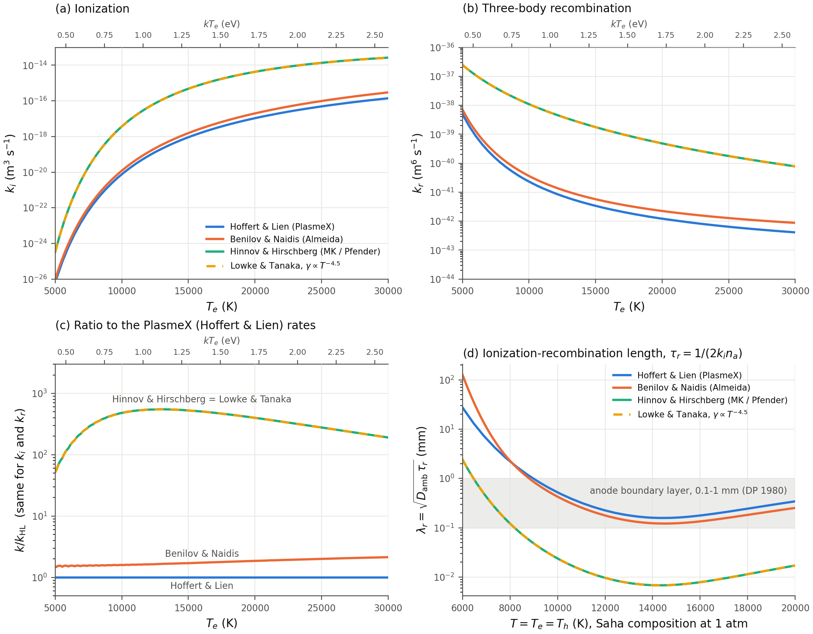
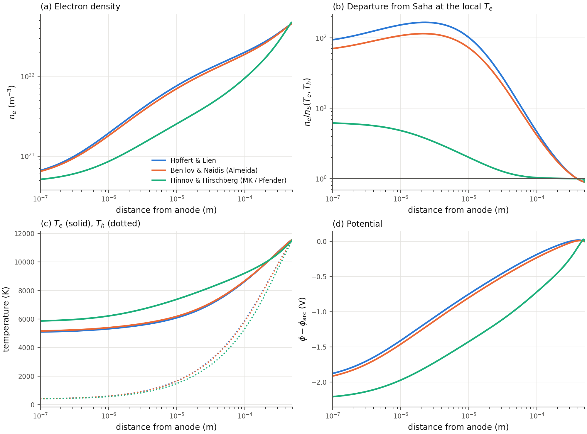

# Ionization and recombination rates for the electrode region

Four argon rate models appear in the electrode-region work:

| Used by | Model | Source in this repo |
|---|---|---|
| PlasmeX (this paper) | Hoffert & Lien (1967), "HL" | `~/work/PlasmeX/exe/hoff_f.dat`, `hoff_r.dat`; cited as `hoffert1967quasi` |
| Almeida et al. (2008), Semenov et al. (2016) | Benilov & Naidis (1998), "BN" | Almeida App. A; coded in `~/work/PlasmeX/exe/almeida_arc_bc.py` |
| Dinulescu & Pfender (1980) | Hinnov & Hirschberg (1962) via Mitchner & Kruger Ch. IX, "HH" | `References/Chapt_9_Ionizational_Nonequilibrium.pdf` eqs (4.13), (4.20), (6.8) |
| Lowke & Tanaka (2006), after Sansonnens et al. (2000) | three-body $\gamma\propto T^{-4.5}$ "of Hoffert & Lien at low temperatures", "LT" | `References/2006_Lowke_Tanaka_LTE_diff_approx_arcs_model.pdf` eq (1), Sec. 6 |

(The PlasmeX tables are named `hoff_*`, but the source is Hoffert & Lien, not "Hoffmann".)

The figure is `rates_comparison.pdf` / `.png`. Run `python3 plot_rates.py` to regenerate it and the numbers quoted below. The script loads the PlasmeX tables and the BN formulas from the live PlasmeX tree through `figures/validation_fig/plasmex.py`. Nothing is copied.



---

## 1. One common form

All four models keep only electron-impact ionization and its inverse, three-body recombination with an electron as the third body:

$$
\dot n_e = k_i\, n_e n_a - k_r\, n_e^2 n_i ,
\qquad
\left(\frac{n_e n_i}{n_a}\right)_{\!S}\! = S(T_e) = 2\frac{g_+}{g_a}\left(\frac{2\pi m_e kT_e}{h^2}\right)^{3/2} e^{-I/kT_e},
$$

with $g_+/g_a = 6$ and $I = 15.75$ eV. Where a model satisfies detailed balance, $k_i/k_r = S(T_e)$, so $\dot n_e = 0$ gives Saha at $T_e$. In that case one coefficient sets both rates, and a ratio between two models (Fig. c) is the same for $k_i$ and $k_r$.

### 1.1 Hoffert & Lien: PlasmeX

PlasmeX reads $k_i(T_e)$ and $k_r(T_e)$ from tables (`exe/chemistry.H`, `chem_rxn`) and interpolates linearly in $T_e$[eV] on $\log k$. No formula ships with the tables, so I worked out what they contain:

- **$k_i$** fits HL's two-step (excitation-limited) electron–atom form to an rms error of 0.1 % in $\ln k$:
$$
k_i^{\rm HL} = C_e\,\bar c_e\,(\varepsilon^* + 2kT_e)\,e^{-\varepsilon^*/kT_e},\qquad
\bar c_e=\sqrt{\frac{8kT_e}{\pi m_e}},\quad C_e = 7.0\times10^{-22}\ {\rm m^2/eV},\quad \varepsilon^*\simeq 11.67\ {\rm eV}.
$$
  This is a cross section that rises linearly from a threshold inside the Ar 4s manifold (11.55–11.83 eV), averaged over a Maxwellian at $T_e$. The rate-limiting step is excitation of the first excited (4s) level. Ionization from that level is assumed fast.
- **$k_r = k_i/S(T_e)$.** The table ratio $k_f/(k_r S)$ is 0.984–0.998 between 1 and 8 eV, so the tables are Saha-consistent at $T_e$.
- The tables depend on $T_e$ only. HL's model also has an atom–atom ($T_h$-driven) ionization channel. PlasmeX leaves it out, which is reasonable near an electrode, where $T_h$ is low.

### 1.2 Benilov & Naidis: Almeida 2008 and Semenov 2016

Almeida App. A (p. 23) gives:

$$
k_i = k_{\rm dir} + \beta\,k_{\rm step},\qquad \beta = \frac{n_e}{n_e+n_e^{(0)}},\qquad n_e^{(0)} = 10^{21}\ {\rm m^{-3}}\ (\text{Ar}),
\qquad
k_r = \frac{k_{\rm dir}+k_{\rm step}}{S(T_e)} .
$$

From BN (1998), as implemented in `almeida_arc_bc.py`:

$$
k_{\rm dir} = c_i\,\bar c_e\,(I+2kT_e)\,e^{-I/kT_e},\quad c_i = 1.8\times10^{-21}\ {\rm m^2/eV};
\qquad
\frac1{k_{\rm step}} = \frac1{k_1} + \frac1{k_2\,P(\tfrac52, E/kT_e)},
$$
$$
k_1 = 4.3\times10^{-14}\left(\frac{kT_e}{Ry}\right)^{0.7}\left(\frac{\Delta E}{Ry}\right)^{-2.2} e^{-\Delta E/kT_e}\ {\rm m^3/s},\qquad \Delta E = 11.64\ {\rm eV}.
$$

- **Stepwise ionization through the first excited level dominates.** $k_{\rm dir}/(k_{\rm dir}+k_{\rm step})$ is 0.6 % at 8 kK, 4 % at 12 kK and 24 % at 25 kK, and $k_{\rm step}\approx k_1$ to within 1 %. This is the same bottleneck as HL.
- **$\beta$ models radiative escape.** At low $n_e$ the excited atom decays radiatively before an electron can ionize it, so $k_i$ falls but $k_r$ does not. The equilibrium then lies below Saha. $k_i(n_e)/k_i(\beta{=}1)$ is 0.91 at $10^{22}$, 0.5 at $10^{21}$, 0.1 at $10^{20}$ and 0.02–0.05 at $10^{19}$ m⁻³. Almeida estimates $n_e^{(0)}$ for resonance-radiation trapping in a plasma of about 1 mm radius, so it is a geometry-dependent estimate.
- **$k_i$ depends on $(T_e, n_e)$,** not on $T_e$ alone.

### 1.3 Hinnov & Hirschberg via Mitchner & Kruger: Dinulescu & Pfender 1980

Dinulescu & Pfender eq. (8), "taken from Ref. 12" (Mitchner & Kruger), is:

$$
\dot n_e = \alpha\,n_n\left[S(T_e) - \frac{n_e^2}{n_n}\right],
$$

which is MK (4.13), $\dot n_e = \alpha[n_1(n_e^2/n_1)^* - n_e^2]$. For $\alpha$, MK give the Hinnov–Hirschberg formula, (4.20a) and (6.8b):

$$
\alpha \simeq 5.6\times10^{-27}\,n_e\,(kT_e)^{-9/2}\ {\rm cm^3/s}\quad(kT_e\ \text{in eV},\ n_e\ \text{in cm}^{-3}).
$$

In the common form this gives

$$
k_r^{\rm HH} = \frac{\alpha}{n_e} = 5.6\times10^{-39}\,(kT_e/{\rm eV})^{-4.5}\ {\rm m^6/s},\qquad k_i^{\rm HH} = k_r^{\rm HH}\,S(T_e).
$$

HH is a **hydrogenic, purely collisional** model (MK pp. 461–463):
- It assumes a "critical" level $q$ where collisional up- and down-rates balance, $N_q^2 \simeq 13.6/kT_e$, and requires $N_q\gg1$.
- It uses Thomson ionization cross sections for the levels near $q$.

### 1.4 Lowke & Tanaka 2006

Lowke & Tanaka solve the ambipolar electron continuity equation at a single temperature, $T_e=T_h=T$ (their eq. 1):

$$
\nabla\cdot(D_a\nabla n_e) + \gamma\,(G\,n_e n_0 - n_e^3) = 0,\qquad G = \frac{n_e^{*2}}{n_0^*}(T),
$$

so $k_r = \gamma$ and $k_i = \gamma G$, with $G$ the Saha function at $T$. For $\gamma$ they say only (Sec. 6): "As in the computation of Sansonnens et al (2000), we have used the recombination coefficients of Hoffert and Lien (1967) at low temperatures, which are proportional to $1/T^{4.5}$." **They give no prefactor**, and neither Sansonnens et al. nor Hoffert & Lien is in `References/`.

- The script assumes $\gamma = 1.09\times10^{-20}\,T^{-4.5}$ m⁶/s ($T$ in K). This is the HH coefficient of §1.3 written in kelvin ($5.6\times10^{-39}\times11604.5^{4.5} = 1.096\times10^{-20}$), so LT lies on HH to 0.4 % in the figure. **Check this prefactor against Sansonnens et al. (2000) before quoting it.**
- It is not the $T\to$ low limit of the PlasmeX HL table: $k_r^{\rm HL}=k_i^{\rm HL}/S$ grows like $e^{(I-\varepsilon^*)/kT}$ at low $T$, not as a power law (local slope $d\ln k_r/d\ln T$ = −4.7 at 1.07 eV, −43 at 0.08 eV).
- Since $T_e=T_h$, "$T_e$" on the figure axes is simply $T$ for LT.

---

## 2. How the three compare (figure)

**(a), (b): rates.** BN is drawn and tabulated at $\beta = 1$, the $n_e\gg n_e^{(0)}$ limit that holds over almost all of the PlasmeX anode layer (§5: $n_e<10^{21}$ m⁻³ only within 0.2 µm of the wall). LT coincides with HH (§1.4) and is drawn dashed over it. HH/HL and BN/HL are the same for $k_i$ and $k_r$.

| $T_e$ (K) | $kT_e$ (eV) | $k_i$ HL (m³/s) | $k_i$ BN | $k_i$ HH | BN/HL | HH/HL |
|---|---|---|---|---|---|---|
| 8 000 | 0.69 | 2.2e-22 | 3.5e-22 | 7.4e-20 | 1.57 | 333 |
| 10 000 | 0.86 | 7.6e-21 | 1.2e-20 | 3.7e-18 | 1.59 | 481 |
| 12 000 | 1.03 | 8.2e-20 | 1.3e-19 | 4.5e-17 | 1.63 | 542 |
| 15 000 | 1.29 | 9.1e-19 | 1.6e-18 | 4.8e-16 | 1.71 | 527 |
| 20 000 | 1.72 | 1.1e-17 | 2.0e-17 | 4.3e-15 | 1.86 | 400 |
| 25 000 | 2.15 | 4.9e-17 | 9.8e-17 | 1.4e-14 | 2.00 | 278 |

- **HL and BN agree within a factor 1.5–2.** That is expected, since both are rate-limited by electron-impact excitation of the first excited level and both use detailed balance with Saha at $T_e$. BN is higher because its $k_1$ fit is larger and it adds a small direct-ionization term.
- **BN at low $n_e$** (not drawn): at $10^{20}$ m⁻³, $k_i$ falls up to about 7× below HL at 5–10 kK and converges toward HL at high $T_e$. Its $k_r$ does not change.
- **HH (and LT with the assumed prefactor) is 130–540× faster than HL** over the arc range. It is not a small correction.

**(c): ratio to the PlasmeX rates.** The small ripples below 6 kK come from the log-linear interpolation of the PlasmeX tables between nodes.

**(d): what the difference means physically.** Ionization equilibrium breaks down where the ionization–recombination length

$$
\lambda_r = \sqrt{D_{\rm amb}\,\tau_r},\qquad \tau_r = \frac{1}{2k_i n_a},\qquad D_{\rm amb} = (1+T_e/T_h)D_{ia}
$$

becomes comparable to the gradient length. $\tau_r$ is the linearization of $k_in_en_a - k_rn_e^3$ about Saha at fixed $n_a$. Here it is evaluated at the 1-atm Saha composition, with $D_{ia}$ from Almeida eq. (45) and BN charge exchange.

| $T$ (K) | $n_e$ Saha (m⁻³) | $\lambda_r$ HL (mm) | $\lambda_r$ BN (mm) | $\lambda_r$ HH (mm) |
|---|---|---|---|---|
| 8 000 | 1.5e21 | 2.2 | 2.3 | 0.12 |
| 10 000 | 1.5e22 | 0.52 | 0.43 | 0.024 |
| 12 000 | 6.7e22 | 0.23 | 0.18 | 0.010 |
| 15 000 | 1.8e23 | 0.16 | 0.12 | 0.007 |

- With HL or BN, $\lambda_r$ is 0.1–1 mm, the same size as the anode boundary layer that DP measure (0.1–1 mm dark space, their Fig. 2 and Table II). The layer is therefore really in ionization nonequilibrium.
- With HH or LT, $\lambda_r$ is about 20× shorter ($\sqrt{500}$). The plasma would track Saha almost to the wall, and the nonequilibrium layer would shrink to tens of µm. **The choice of rates changes the structure of the electrode layer, not just a number.**
- Where $n_e < 10^{21}$ m⁻³ (below about 8 kK), BN gives a longer $\lambda_r$ than HL because of $\beta$.

**Check against Dinulescu & Pfender's own numbers.** Their Table I lists $\alpha$ ≈ 2.6–2.7e-17 m³/s. Here is $\alpha = k_r n_e$ from each model at the $(T_e, n_e)$ in that table:

| $T_e$ (K) | $n_e$ (m⁻³) | $\alpha$ DP Table I | HH | BN | HL |
|---|---|---|---|---|---|
| 12 000 | 6.2e22 | 2.6e-17 | 3.0e-16 | 9.0e-19 | 5.6e-19 |
| 13 000 | 1.1e23 | 2.6e-17 | 3.7e-16 | 1.1e-18 | 6.8e-19 |
| 14 000 | 1.4e23 | 2.7e-17 | 3.4e-16 | 1.0e-18 | 6.3e-19 |

- DP's $\alpha$ is nearly constant across the table, which matches the HH trend (∝ $n_eT_e^{-4.5}$, also nearly flat across these rows).
- Its magnitude is about 11× below HH as written in MK and about 30–45× above HL.
- I could not trace the factor of 11. Their transport and rate details are in Dinulescu's thesis (their ref. 15), which is not in `References/`. Either way, their rates sit 1–2 orders above what HL and BN give for argon.

---

## 3. Validity

| | HL (PlasmeX) | BN (Almeida/Semenov) | HH (MK/Pfender) |
|---|---|---|---|
| Atom | argon-specific (4s bottleneck, Ar cross-section slope) | argon-specific (BN Table I data, Ar cross sections) | hydrogenic |
| Derived/validated for | shock-tube ionization relaxation in argon | near-electrode layers of high-pressure arcs (Ar, Hg) | $T_e \lesssim 3000$ K (MK Ex. 4.2); checked against Cs/K data at 1000–4000 K (MK Fig. 7) |
| Saha limit | exact at all $n_e$ | exact only for $n_e\gg10^{21}$; below Saha at low $n_e$ | exact |
| Radiation | none | radiative escape from the first excited level through $\beta$ | none (collision-dominated limit) |
| Depends on | $T_e$ | $T_e$, $n_e$ | $T_e$ (and $n_e$ inside $\alpha$) |

Common to all three:
- They assume a Maxwellian EEDF at $T_e$, including the tail above 11.6 eV. This fails in the sheath and in the inner, low-$n_e$ part of the cathode layer, where Almeida's own discussion applies.
- They assume quasi-steady excited-state populations, i.e. ionization proceeds through a single bottleneck.

HH outside its range:
- The electrode region has $kT_e$ ≈ 0.7–2.5 eV, which is 3–8× above the $T_e\lesssim3000$ K range MK give for the HH approximations.
- At 1 eV the critical level is $N_q\approx3.7$, so the condition $N_q\gg1$ already fails. At 2 eV, $N_q\approx2.6$.
- For argon, the real bottleneck at these temperatures is the large ground → 4s gap (11.6 eV). HL and BN model exactly this; the hydrogenic $T_e^{-9/2}$ law does not. Extrapolating $T_e^{-9/2}$ to $10^4$ K is what makes HH 2–3 orders too fast.

---

## 4. Which is better for the electrode region

1. **Do not use HH (the MK/Pfender rates) for an argon electrode layer.** It is outside its stated validity by a factor of 3–8 in $T_e$ and is not argon-specific. It overestimates both rates by about 300–500×, which shrinks the nonequilibrium layer about 20× (Fig. d). Treat DP's eq. (8) as a qualitative closure, not a rate.

2. **HL and BN are both acceptable, and BN is the better-founded choice for the electrode region.** It describes the same 4s-bottleneck physics as HL, and it also:
   - was built for, and has been used in, near-electrode arc layers (Almeida's cathode, Semenov's anode);
   - accounts for radiative escape, which matters exactly where $n_e$ drops below about $10^{21}$ m⁻³, i.e. in the cold, low-density part of the layer next to the wall.
   
   At $n_e\gg10^{21}$ the two differ by only 1.5–2×, which is 20–30 % in $\lambda_r$.

3. **Practical consequences for the paper.**
   - **Validation.** For the Almeida cathode and Semenov anode comparisons, part of any mismatch in the ionization-layer thickness or the $n_e$ profile can come from the rates (HL vs BN) rather than from the transport model. One way to separate the two is a PlasmeX run with BN rates at $\beta=1$. This needs only two new tables, $k_i^{\rm BN}(T_e)$ and $k_r^{\rm BN}(T_e)$, in `hoff_*` format, and no code change.
   - **Full BN.** Including $\beta$ needs a code change, because $k_i$ then depends on $n_e$: tabulate $k_{\rm dir}$ and $k_{\rm step}$ separately and form $k_{\rm dir}+\beta k_{\rm step}$ in `chem_rxn`.
   - **Check $n_e$ at the electrode.** If $n_e$ at the electrode stays above about $10^{21}$ m⁻³ in your anode/cathode runs (DP state this for their anode), $\beta$ is irrelevant and HL vs BN is only the factor 1.5–2.
   - **Paper text.** The model section could justify the HL choice in one sentence: argon-specific, excitation-limited, detailed-balanced with Saha, within a factor 2 of the BN rates used by Almeida/Semenov. That sentence could also say why the HH rate used by DP is not used. (This is a suggestion only; the paper is unchanged.)

---

## 5. Implementation in PlasmeX (`prob.rxn_rates`)

All three models are now in PlasmeX and are selected in the deck:

```
prob.rxn_rates = hoffert_lien     # or almeida, or saha   (exe/anode_inputs)
```

| Value | Model | $k_i$ | $k_r$ |
|---|---|---|---|
| `hoffert_lien` (default) | Hoffert & Lien, the `hoff_*.dat` tables | table($T_e$) | table($T_e$) |
| `almeida` | Benilov & Naidis / Almeida App. A (§1.2) | $k_{\rm dir}+\beta(n_e)\,k_{\rm step}$ | $(k_{\rm dir}+k_{\rm step})/S$ |
| `saha` | MK (4.13) / Dinulescu & Pfender eq. (8), Hinnov–Hirschberg $\alpha$ (§1.3) | $k_r S$ | $5.6\times10^{-39}(kT_e)^{-4.5}$ |

Where the code is:
- **`exe/chemistry.H`, namespace `argon_ion`, `rate_coeffs(Te_ev, ne, prob_parm, ki, kr)`.** `chem_rxn` calls it, so the same rates reach both integrators (Advance and Newton).
  - $S$ uses $g_+/g_1=6$ and $I=15.75$ eV for both analytic models, so all three share one Saha equilibrium, to within the tables' 2 %.
  - $e^{-I/kT_e}$ is cancelled analytically in $k_r$, so a cold cell next to the wall gives $k_i=0$ and a finite $k_r$, not 0/0.
  - The energy charged per ionization stays 15.76 eV for all three.
- **`exe/prob.H`** parses `prob.rxn_rates` and prints the choice at startup.
  - Under `prob.arc_lte = 1` it reads the arc $n_{eq}$ automatically from the selected model's column of `ar_eq.dat`: column $1+2\cdot$`rxn_rates`.
  - The equilibrium check uses the selected rates, so a stale table or the wrong pressure still aborts.
- **`exe/gen_arc_eq_table.py`** writes one `ar_eq.dat` holding all three equilibria: columns `T`, then `n_eq, dn_eq/dT` for hoffert_lien, then almeida, then saha. For `almeida` it solves the $\beta(n_e)$ balance per node.
  - The hoffert_lien columns are byte-identical to the old table.
  - An old 3-column table still works for `hoffert_lien`. For `almeida` or `saha` it aborts with "expected at least 4 columns"; rerun `gen_arc_eq_table.py` to fix it.
  - The tabulated arc density at 11 583 K is 5.15e22 (HL), 5.14e22 (Almeida) and 5.18e22 m⁻³ (saha).
- **`src/read_write.H`** writes `prob.rxn_rates` (0/1/2) into every plotfile's `plasmex_info`.
- **`src/aider.H`**: the "T_e outside hoff table" warning is printed only under `hoffert_lien`.

Checks run:
- **Default unchanged.** With `hoffert_lien`, the regression test (A: single level, 50 steps; B: deck as shipped, 200 steps) is bit-identical to the code before the change.
- **C++ = Python.** `rate_coeffs` agrees with `almeida_arc_bc.py` and the MK formula to ≤3e-8 (the residual is the two codes' $m_e$ constants) from 300 K to 100 kK and $n_e$ = 1e19–1e23.
- **FPE traps.** DEBUG builds with `fpe_trap_invalid` and `fpe_trap_zero` are clean for `almeida` and `saha` under both integrators. The 2-D build compiles.
- **`arc_lte = 1`.** Each model starts from its own column of the combined table (check residual ≤ 4e-6).

### Steady anode layer with each model

These runs use `anode_inputs` as it is now, changing only `prob.rxn_rates`, with Newton pseudo-transient (`imp_order = 1`) run to the steady-state trigger. All three converged. Two Newton step failures occurred with `saha`, and both recovered.



| Model | $n_e$ at anode (m⁻³) | $n_e/n_S$ at anode | $T_e$ at anode (K) | $n_e/n_S$ at 10 µm | $n_e/n_S$ at 100 µm | $\phi_{\rm wall}-\phi_{\rm arc}$ (V) |
|---|---|---|---|---|---|---|
| hoffert_lien | 5.1e20 | 80 | 5066 | 103 | 4.6 | −1.99 |
| almeida | 5.1e20 | 61 | 5136 | 73 | 4.1 | −2.02 |
| saha | 4.7e20 | 6.5 | 5820 | 2.0 | 1.04 | −2.24 |

(Regenerate with `python3 compare_steady.py hoffert_lien=<plt> almeida=<plt> saha=<plt>`.)

- **HL vs Almeida.** The layer is almost the same. $n_e$ differs by less than 10 % everywhere, and the departure from Saha is about 25 % smaller with Almeida, as expected from rates 1.6× faster.
  - $\beta$ hardly matters in this run: $n_e$ falls below $10^{21}$ m⁻³ only within about 0.2 µm of the wall.
- **Saha (Hinnov–Hirschberg).** The ionization-nonequilibrium layer almost disappears.
  - $n_e$ follows Saha to within 4 % at 100 µm; with HL it is 4.6× above Saha there.
  - $n_e$ in the bulk of the layer is 2–3× lower, $T_e$ at the anode is about 750 K higher, and the potential drop is 0.25 V larger.
  - The field changes too. In the arc-side cell it goes from −581 (HL) and −512 (Almeida) to −5489 V/m. In the wall cell it falls from 1.2e6 (HL) and 1.1e6 (Almeida) to 2.5e5 V/m.

This is the λ_r argument of §2 seen in a full solution.
